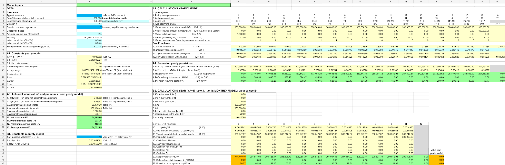

# Premium and Reserve Foundations

## Objective

Calculate premiums and provisions for a general life insurance contract in both yearly and monthly models. The workbook supports term-life and endowment structures with variable premium-payment periods.

## Model components

- Present-value and discount factors
- Mortality and survival probabilities
- Initial and recurring expense components
- Net and gross premium calculations
- Yearly provision recursion
- Monthly provision recursion within each policy year

## Workbook navigation

1. Start with `Portfolio Overview`.
2. Review mortality and actuarial-value inputs in `Input`.
3. Review yearly premium and provision schedules in `Calculation case 1`.
4. Continue to the monthly recursion schedule in the lower section of the same worksheet.

## Preview

