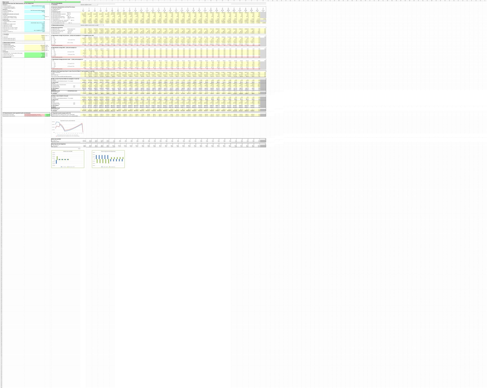

# Life Insurance Reserving and Profit Analysis

## Objective

Model a combined deferred life annuity and decreasing term life insurance contract. Calculate premiums, provisions, balance sheets, profit and loss, expected results, dividends, and present values.

## Model components

- Mortality and survival assumptions
- Net, acquisition-cost, and expense components of the premium
- Net provision, deferred acquisition cost, and expense reserve roll-forwards
- Survival and death-outcome financial statements
- Expected profit and dividend projection
- Actuarial present-value calculations

## Workbook navigation

1. Start with `Portfolio Overview`.
2. Review editable product and assumption inputs in `Data insurance`.
3. Review the principal model in `Calculation case 2`.
4. Use the charts below the projection to inspect profit emergence and reserve components.

## Preview

