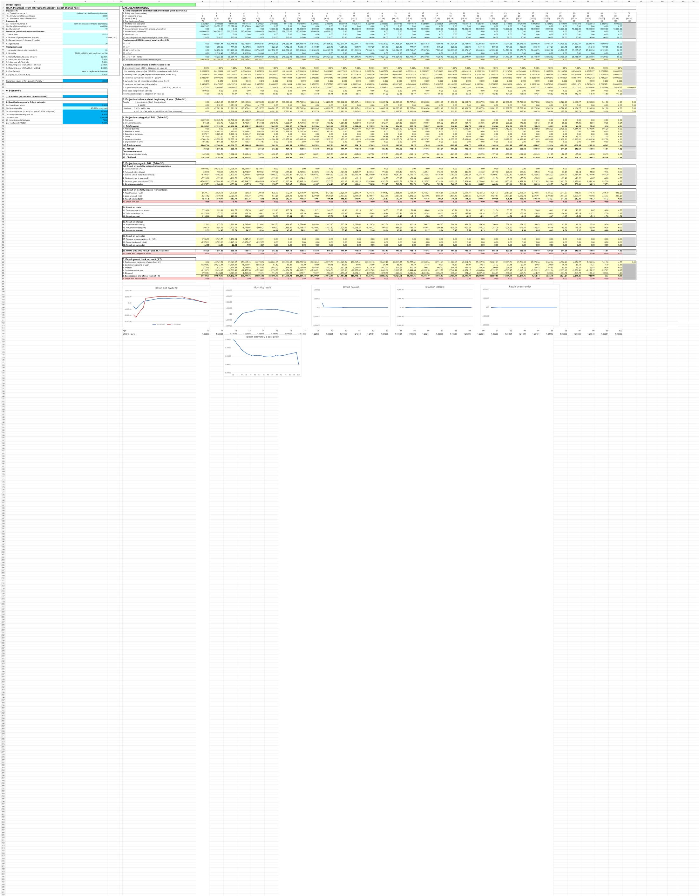

# Scenario-Based Actuarial Profit Decomposition

## Objective

Project insurance profit under cost-price and best-estimate assumptions and explain the result through mortality, expense, interest, and surrender components.

## Model components

- Projected mortality and policy survival
- Cost-price and best-estimate scenario controls
- Balance sheet and categorical profit-and-loss projection
- Organic result analysis
- Mortality, expense, interest, and surrender result decomposition
- Dividend and present-value analysis

## Workbook navigation

1. Start with `Portfolio Overview`.
2. Review product inputs in `Data insurance`.
3. `Calculation case 2` supplies the underlying provision and premium model.
4. Review the main scenario model and six output charts in `Calculation case 3`.

## Preview

## Limitations

Scenario assumptions are illustrative. The workbook does not include stochastic simulation, parameter calibration, or production-level model governance.

