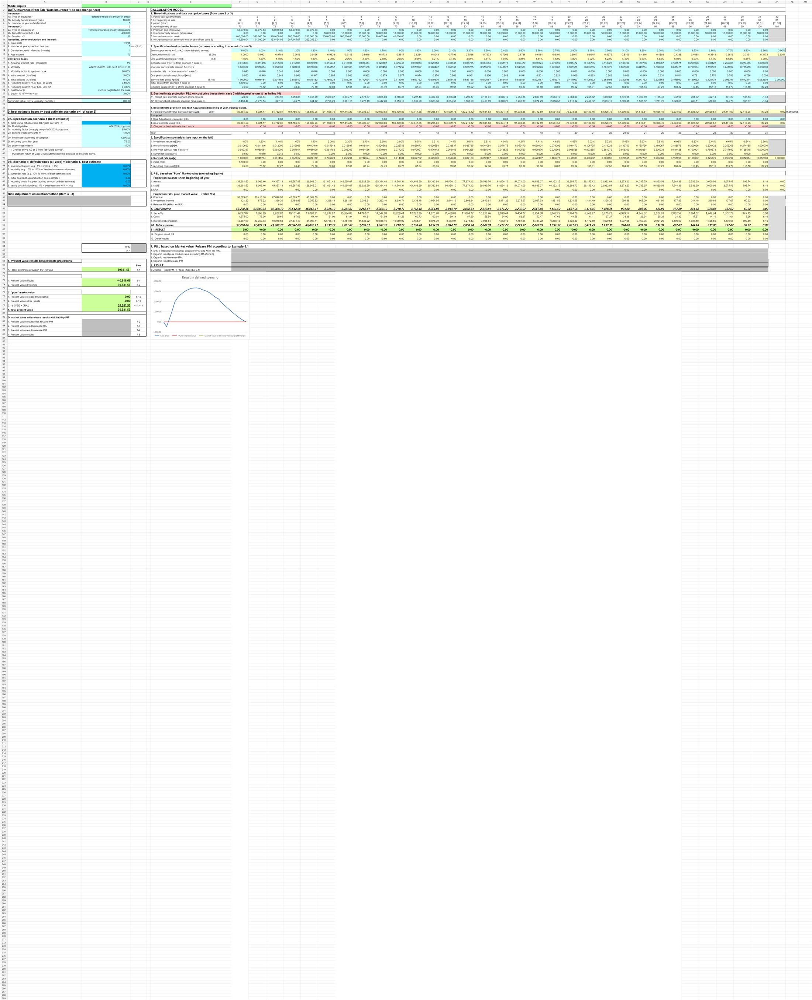

# Market-Value Liability and Yield-Curve Analysis

## Objective

Project insurance liabilities and profit on a market-value basis, apply scenario adjustments, and compare present values across accounting approaches.

## Model components

- Best-estimate liability projection
- Yield-curve and forward-rate calculations
- Mortality, surrender, expense, and investment assumptions
- Market-value balance sheet and profit-and-loss projection
- Present-value comparison of result-recognition approaches

## Workbook navigation

1. Start with `Portfolio Overview`.
2. Review assumptions and supporting calculations in the earlier calculation tabs.
3. Review available curves in `yield curves`.
4. Review the principal model and comparison output in `Calculation case 5`.

## Preview

