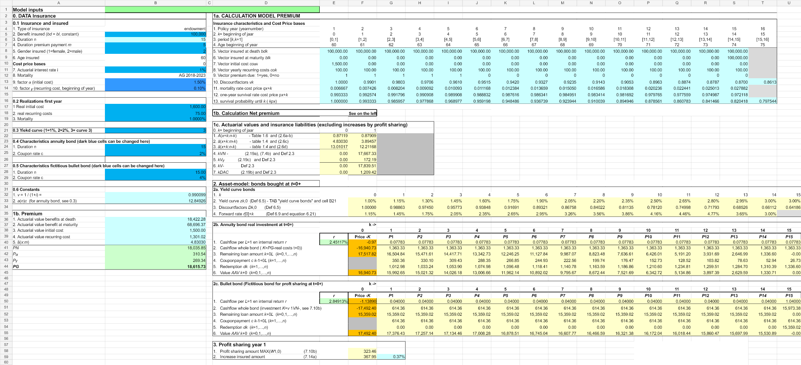

# Profit Sharing and First-Year Bookings

## Objective

Determine first-year profit sharing and accounting bookings for an endowment contract backed by an annuity bond. A fictitious bullet bond is used for the profit-sharing calculation.

## Model components

- Premium and insurance-liability calculations
- Yield-curve discount factors and forward rates
- Annuity-bond cash flows and amortized-cost values
- Bullet-bond cash flows for profit sharing
- First-year profit-sharing amount
- Step-specific accounting bookings and reconciliation

## Workbook navigation

1. Start with `Portfolio Overview`.
2. Review mortality data in `AG 2018-2023 qx (period)`.
3. Review the supplied bond curves in `yield curve bonds`.
4. Review the model and booking schedules in `Calculation case 4`.

## Preview

